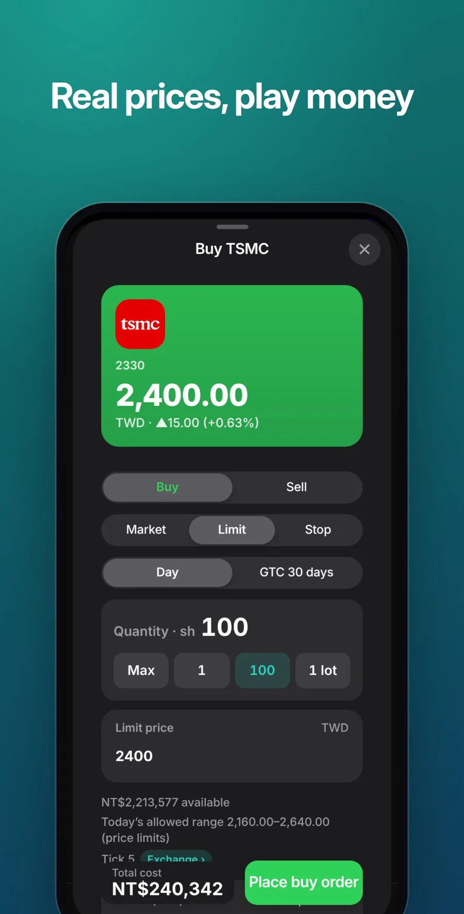
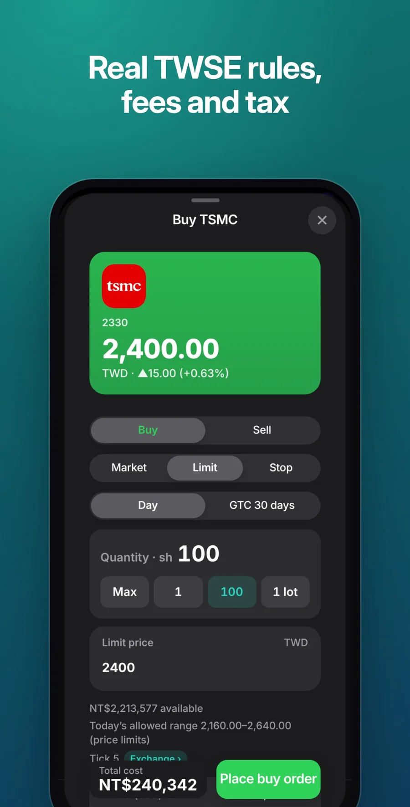
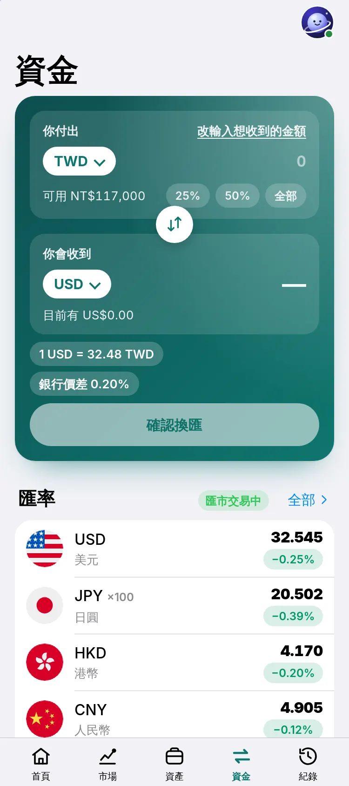

<p align="center">
  
</p>

<h1 align="center">Orbit Securities</h1>

<p align="center">
  <b>Invest worldwide, risk-free.</b><br>
  <a href="https://orbit.jaypengx.com/securities/"><b>orbit.jaypengx.com/securities</b></a>
</p>

<p align="center">
      
</p>

A Taiwan brokerage on play money, with real prices and a real broker's rules. Part of **Orbit**, a family of phone apps for life in Taiwan that share one sign-in, the Orbit Pass. See them all at [orbit.jaypengx.com](https://orbit.jaypengx.com/pass/).

<p align="center">
  
  
  
</p>

## Features

- **Every market a Taiwan investor reaches:** 上市, 上櫃 and 興櫃 stocks, ETFs, warrants, convertibles, futures and options, 複委託 (US, Hong Kong, Tokyo and more), funds, bonds, forex, gold and crypto, each list complete, 50 rows at a time.
- **A real broker's rules:** each market's fees, taxes, ticks, price limits, board lots, lunch breaks, holidays and settlement days; US pre- and post-market; circuit breakers.
- **Orders:** market, limit and stop, quick sizes and a cost preview; whole and odd lots in one tap.
- **Taiwan credit trading:** 融資, 融券, day trading, margin calls at 130% and forced sales, as a Taiwan broker does them.
- **Account opening and eligibility:** KYC, 當沖, warrants, futures and professional-investor status before a product can be bought.
- **Savings and income:** 定存 at Bank of Taiwan's rates, 定期定額 plans, securities lending, dividends on the real pay day, 新股申購 from TWSE's real list.
- **Your portfolio:** net worth over time, allocation, positions, cash in every currency, income, and how you did against 0050, VOO, BTC and gold.
- **Detail pages:** line or candle charts with moving averages, the facts, your position, price alerts and a plain-language read of the company or fund.

## Tech stack

| Layer | What |
| --- | --- |
| App | Plain JavaScript (ES modules), HTML and CSS; no framework, no build step, no dependencies |
| Platform | Installable web app with a service worker; covered when offline (never trades on old prices) |
| Shared | Look, Orbit Pass and notices from the kit in [Orbit-Core](https://github.com/JayPengX/Orbit-Core); the broker rules are the kit's `stock-*.mjs`, one copy for the app and the server |
| Prices | Yahoo Finance through the Orbit proxy, refreshed every 45 s while on screen |
| Orders | Filled by the proxy (`stock-fill.js`, Cloudflare Workers) at a fresh quote or from 5-minute bars, never by the phone |
| Lists | Every listing, fund, logo and Chinese name generated from TWSE, TPEx, HKEX and JPX open data by scripts |
| Tests | `node --test` on the ledger, fees, credit, savings and eligibility |

## How it works

```
the ticket ──► order event in the account log
                    │
                    ▼
     api.jaypengx.com/stock (stock-fill.js): filled at the market's terms, dated when it happened
                    │
                    ▼
     the log replayed ─► cash · holdings · cost · loans · P/L
```

- **The account is a log** (`lib/account.mjs`): immutable events and orders whose status only moves forward. Every figure comes from replaying it, and two devices merge by uniting logs.
- **The server checks the money:** `stock-check.js` replays the account itself; a phone's own figures never add money.
- **What you see before is what happens after:** the ticket's estimate, a short's limit and a 定存's end use the same rules that then carry it out (`lib/preview.mjs`).

The full rule list and the decisions still in force: **[MAP.md](MAP.md)**.

## Project structure

```
public/
├── index.html, app.js, styles.css   rendering and wiring
├── lib/                 26 modules
│   ├── account, markets, credit, savings, bonds, ipo, access, codec, holidays
│   │                    re-exports of the kit's stock-*.mjs (the rules live there)
│   ├── quotes.mjs, catalog.mjs      Yahoo reads; the curated lists
│   ├── chart.mjs, format.mjs, i18n.mjs
│   ├── orders.mjs, preview.mjs, foryou.mjs, series.mjs
│   └── brands, tvlogos, tvround, twnames   generated logo and name tables
├── data/                every market's listings (generated)
├── logos/, flags/       company logos and flags
└── sw.js
scripts/                 listings, funds, logos and names generators
tests/                   node --test
MAP.md                   how it works
```

## Getting started

The app loads the shared kit from a sibling folder, so clone this repo next to [Orbit-Core](https://github.com/JayPengX/Orbit-Core):

```bash
git clone https://github.com/JayPengX/Orbit-Core.git
git clone https://github.com/JayPengX/Orbit-Securities.git
cd Orbit-Securities
```

Requirements: Node.js 22 or newer. There is nothing to install: no framework, no `node_modules`.

```bash
npm test   # links ../Orbit-Core/kit as .kit, then runs node --test
```

See it on a phone-sized screen, signed in with a made-up wallet and real data (needs Playwright):

```bash
# a screenshot, saved in /tmp/orbit-preview
node ../Orbit-Core/tools/preview.mjs securities --live --width 375
# serve it, then open http://localhost:8123/Orbit-Securities/
node ../Orbit-Core/tools/preview.mjs securities --live --serve --port 8123
```

`--dark`, `--lang en`, `--webkit` (Safari's engine) and the other flags are listed in [Orbit-Core/tools/README.md](https://github.com/JayPengX/Orbit-Core/blob/main/tools/README.md).

Add `--fake-yahoo` when Yahoo answers 429. The logo and name tables are generated (`scripts/brand-logos.mjs`, `tv-logos.mjs`, `tv-round.mjs`, `tw-names.mjs`): never edit them by hand.

## Deploying

Push to `main`. GitHub Actions runs the tests, stamps every file with its content hash (so a phone downloads only what changed) and publishes `public/` to GitHub Pages; the site Worker serves it at its orbit.jaypengx.com address. There are no pull requests or release branches.

## Part of Orbit

| App | What it is |
| --- | --- |
| [Orbit Sports](https://github.com/JayPengX/Orbit-Sports) | Every game you can watch in Taiwan, live |
| [Orbit Transit](https://github.com/JayPengX/Orbit-Transit) | Bus, train, metro and YouBike, planned and navigated |
| [Orbit Weather](https://github.com/JayPengX/Orbit-Weather) | One clear forecast, to the township |
| [Orbit Words](https://github.com/JayPengX/Orbit-Words) | English vocabulary that stays |
| [Orbit Securities](https://github.com/JayPengX/Orbit-Securities) | A Taiwan broker on play money |
| [Orbit Class](https://github.com/JayPengX/Orbit-Class) | Today's classes at a glance |
| [Orbit Beats](https://github.com/JayPengX/Orbit-Beats) | Endless music and your own beats |
| [Orbit Law](https://github.com/JayPengX/Orbit-Law) | Laws, rulings and bills, linked |
| [Orbit Money](https://github.com/JayPengX/Orbit-Money) | Your own books |
| [Orbit-Core](https://github.com/JayPengX/Orbit-Core) | The kit, the Orbit Pass and the Workers behind them all |

How it was all built, in pictures and numbers: [jaypengx.com/showcase](https://jaypengx.com/showcase/).
